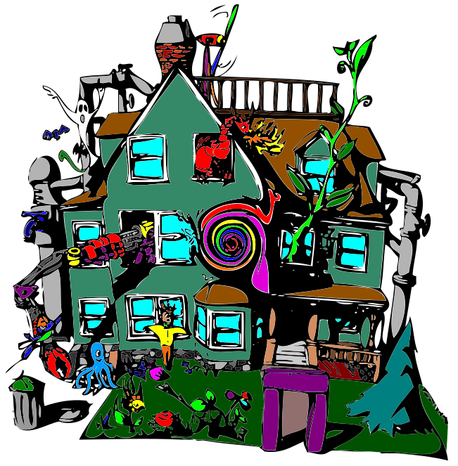

---

layout: default 
title: About
permalink: /about

---

## Culture

We are a continuing experiment in cooperative living. We cook together, clean together, and make all house decisions by consensus. There's art on every wall, instruments everywhere, and spontaneous dance parties in the kitchen. Our pantry yells if you leave it open, and our rooms have bizarre names.

There is no "typical pikan". We have a wide array of interests and personalities. But if you want a place that is weird and wonderful, that loves roasting vegetables, that's sex positive and queer friendly, independent and thrifty, artsy and nifty, we might be the place for you. 

## House

{: .imgPlain}

pikans call home a 3-story former boarding house, vintage 1910. The house has been continually remodeled and improved since its purchase in 1970 and currently contains 13 doubles and 7 singles, making capacity about 33 people. At the beginning of each term, pikans fill out a room/roommate preference survey and an ILP algorithm suggests a rooming arrangement. Everyone then meets to discuss adjustments and ensure everyone is satisfied with the final arrangement. There's no seniority, so incoming pikans are just as likely to get their preferred arrangement as old hats. But because of this process, pika does not guarantee singles to any resident.

All of the rooms at pika have unique characteristics from lofts or sleeping closets to window seats, hardwood floors, murals, and porch access. pikans can also choose to make substantial changes to their rooms. That doesn't just mean they're allowed to paint the walls, that means they're allowed to MOVE the walls - with the approval of the rest of the house, of course. Each room contains two Ethernet connections for high-speed (gigabit) internet access, and there is wireless access throughout the house.

Other features include a computer/study room, a darkroom, 2 free washers and driers, bicycle storage areas, a TV room/library, 2 living rooms, a storage room, extra bicycles for emergency use, a piano and many other instruments, an open pantry, a workroom with a wide selection of tools, an industrial kitchen, a massive dinning room, parking, front/back yards, and an intricate series of porches and decks.

[Virtual House Tour](/tour)

## Co-op Life

What is co-operative housing? For one thing, it means that the residents are responsible for maintaining the house. All pikans gather once a week to tidy and clean every part of the house from the dining room to the bathrooms (we call this "Sunday House Improvement Tasks", or "SHITS"). In addition, each semester we elect a new house manager. There are always two house managers, who are responsible for overseeing house functions and taking care of any problems that might arise.

Being a co-op also means that we have no seniority, and no pledge period. Once you accept a bid at pika, you are a full member, with the same rights and privileges as everyone else. As a member, there are a few requirements in addition to the house duty and kitchen duty. We all participate in four house functions per year: work week, a week at the end of August where we clean and repair the house; work weekend, a weekend in February reserved for cleaning the house and doing bite-sized home-improvement projects; and retreat, a weekend trip to somewhere pretty, where we discuss issues related to living at pika; and mini-retreat, a day-long meeting in the fall.

On average, each member contributes 2-4 hours per week to "co-operative living", through some combination of SHITS, mealplan cooking/cleaning, and elected positions (e.g. house manager, treasurer).

pika occasionally throws large-scale social events (about once or twice per semester), although residents have small gatherings of friends and housemates much more often. It's common (and encouraged) for pikans to "lure" social or study groups to pika with the promise of free food and/or extra friends.

## History

 After beginning to coalesce in 1969, pika formally began as the Eta Delta chapter of Pi Kappa Alpha (aka PiKA), an all-male fraternity. In the mid-70s, Eta Delta chapter PiKA started the process to split from the national organisation of Pi Kappa Alpha, because it wanted to be co-ed and allow women to be full-fledged members, and National refused. It refinanced the mortgage at a better rate with MIT, and by 1982 all connections with national Pi Kappa Alpha had been severed. We stopped using the names "Pi Kappa Alpha" and "PiKA," and now refer to ourselves as "pika" (all lowercase, even at the beginning of sentences).

pika has always practiced co-operative living, and has generally been very gender-diverse, even when MIT was not.

In the fall of 2001, started accepting graduate students, and they are some of our most beloved members!

Read [pika's favorite legends](/legends)!