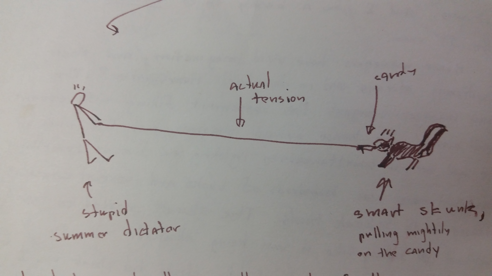

---

layout: default 
title: Legends 
permalink: /legends

---

### Three Rules of pika

pika once had three rules:

1.  Keep it ignorable.
    A useful strategy for most of pika\'s living-together policies. Do
    whatever you want, as long as it\'s possible for other people to
    ignore it if they want to.
2.  Sex in public is public sex (circa 1970s).
    Traditional pika lore says that this was very necessary in the 70s
    to keep people from feeling left out.
3.  No eating chocolate chips straight out of the bag.
    We totally don\'t do that. Nope.
4.  Growl at all trash cans

These rules were abolished in favor of the rule that pika has no rules.
Of course, this is more of a philosophy than a hard and fast rule, not
to mention that pika doesn\'t do a very good job of even being
philosophically true to this philosophy.

There\'s a disputed fifth rule: No going down the fire pole in the rain.
This has been empirically tested and confirmed to be a very bad idea.
Turns out our fire pole is very tall and friction-dependent.

------------------------------------------------------------------------

### The Detonation de Leche

Once upon a time, Daniel Parker \'15 decided to make dulce de leche.
This process involved simmering a closed can of condensed milk in
boiling water, which he did. He and other pikans then presumably
proceeded to do normal everyday pikan things while the can simmered.
They were chatting idly when interrupted by a massive explosion. The can
had evidently gotten too hot and expanded. The lid of the pot was across
the room and \"there was condensed milk and can shrapnel on every single
wall\". No one was hurt, but this goes down in history as one of pika\'s
most potentially deadly kitchen debacles.

------------------------------------------------------------------------

### Shoeblade

The official recreational activity (\"sport\") of pika is shoeblade.
Many a pikan has entered the murph on a warm summer night to engage in a
hearty round of shoeblade with his/her fellow housemates. The official
beverage of shoeblade players is the bittermelon smoothie.

The goal of shoeblade is to put as many shoes as possible on the six
blades of the ceiling fan in the Murph using a firestaff. Players must
remain seated in one of the couches and may only use a firestaff to lift
shoes from ground level to ceiling-fan level.

The illustrious evolution of shoeblade into its present form has lead to
a vast lexicon of shoeblade-specific terminology. A brief glossary
follows:

**rotor** - An extremely difficult move in which a player shoes the
blade by rotating the fan such that it knocks the shoe off the
firestaff, landing on the blade. Should only be attempted by
technically-skilled players.

**blender** - A failed attempt to pull a rotor.

**cranking** - Slang for playing shoeblade. A traditional cheer by
shoeblade spectators is, \"Crank it!\" (often yelled when the blade is
about to be shod).

**inverse shoeblade** - Removing shoes from the blade using a firestaff.

**the Brian Hepler** - Removing shoes from the blade using one\'s arms.

**the Great Migration** - Accidentally knocking off all the shoes
already on the fan while playing shoeblade.

**the Shoeblade Blues** - The official anthem of shoeblade. Lyrics: *I
went down to the river / got down on my knees / and then I played
shoeblade*.

------------------------------------------------------------------------

### The Skunk

(Story (including picture) copied verbatim from a 2011 Murph Book entry
by Marc Rios, pika alum.)

It was the height of summer. I was the summer dictator. I was nocturnal
at the time\--I enjoyed reading in the basement when it was quiet. This
time I was reading at 4:30am in the TV room, with the door propped open.

I heard a rustling behind me, and looked to see who it was. And I saw a
bushy tailed skunk walk into the TV room.

House managers have vivid imaginations, and their daydreams always end
in disaster. Hear water? The house manager imagines the basement filling
with sewage. Smell smoke? The house manager imagines that the wires in
the wall are all simultaneously lighting on fire or something. My
nightmare was hundreds of books and several couches doused with skunk
thiols. The skunk needed to leave without feeling like it was being
attacked.

I left the room and stupidly closed the skunk in. I went to fetch
Caveman Sam Coradetti so he could help me. We hatched an awesome plan:
tie a shoelace around a candy bar and lure the critter out with
chocolate!

What could go wrong?

So I tried to lure it out. And the skunk decided that he wasn\'t going
to follow the candy like a dope\--he was going to snatch the chocolate
and play tug of war!

{: .imgPlain}

I tried to yank the critter out of the room, forgetting that my reward
for success would be a face full of stinky fluids shot from the scent
glands of a skunk out of its ass. This may have been one of the few
times in my life that I was blinded by the adrenaline rush of
competition.

The skunk won. As it at its reward, I regrouped with Sam. \"I have an
idea.\" Sam, who was too tired to tell me that my last idea sucked,
listened.

\"We should block off the stairs. And then I\'ll have a staring match
with it.\"

\"Ok.\" Sam was definitely just saying this so he could watch me get
nailed.

There was some reason behind this plan. I thought the skunk reminded me
of my deceased pet ferret. Ferrets get nervous when you stare at them.
And then they leave.

So I stood in the center of the TV room and stared at the skunk. I
watched it for five minutes before it got spooked and left for the back
door.

Victory! HA! Take that, skunk!

------------------------------------------------------------------------

### First Impressions

Once, Adam Rodriguez \'15 brought a somewhat conservative friend to
pika. This happened to be during a \"naked baking\" event, and the
friend walked into the house to find a bunch of pikans in various states
of undress chilling in the Murph, watching TV shows while they waited
for their cookies to be done. She freaked out and Adam took her to the
back porch to console her and explain clothing-optionality. Just as he
got her calmed down, another pikan came flying down the firepole at
them\--topless.

------------------------------------------------------------------------

### The Headless Squirrel

Lilah enjoys biting the heads off animals. Once, Ben T. \'13 found a
headless squirrel outside the back door. He put on gloves, obtained two
Ziploc bags, and double-bagged the squirrel. He then removed the gloves
and excitedly ran throughout the house, showing off his new friend. His
human friends watched with mixed amusement and disgust. Eventually,
saying \"Look what I found!\" and shaking the bag to make the squirrel
dance got kind of old, so Ben taped up the bag in the dining room to be
prominently displayed with our collection of funny news articles. It
stayed there for what was probably no more than a day, but seemed like a
very, very long time to look at a headless dead squirrel.

------------------------------------------------------------------------

### Disappearing Murph Books

Sometimes Murph Books (pika\'s community sketchbooks, which are kept in
public spaces and filled with random anecdotes, drawings, feelings,
quotes, whatever) get absorbed somehow into the pika house. This
happened with two successive books in Spring \'15; the books have not
yet been found. There\'s also a note in a book from 2010: \"Lost Murph
Book Count: 2\". Prophetic?

------------------------------------------------------------------------

### Judgemental Plebeians

Once, a pikan was chatting with a match on Tinder. The pikan made a
casual, flirty joke, but the match took it very seriously and responded
with a multi-page rant about how she would be sorry when he was rich and
famous. (This rant was punctuated and further provoked by the pikan
writing progressively larger ASCII penises, and making no other
response.) This exchange culminated in the line \"I\'m a f@#cking
legend, and you\'re a judgemental plebeian\". This was read aloud to
pika on a few occasions, and became a meme of its own.

------------------------------------------------------------------------

### The Murph Story

Tradition dictates that this 100% true story, based on an even truer
story, is only ever told in our living room, which is called \"the
Murph\". So come by and take a house tour, and we\'ll tell it to you.

## Even Older [Legends](https://web.archive.org/web/20141105233231/http://www.housecorp.org/reminiscence) and [Tour](/tour)